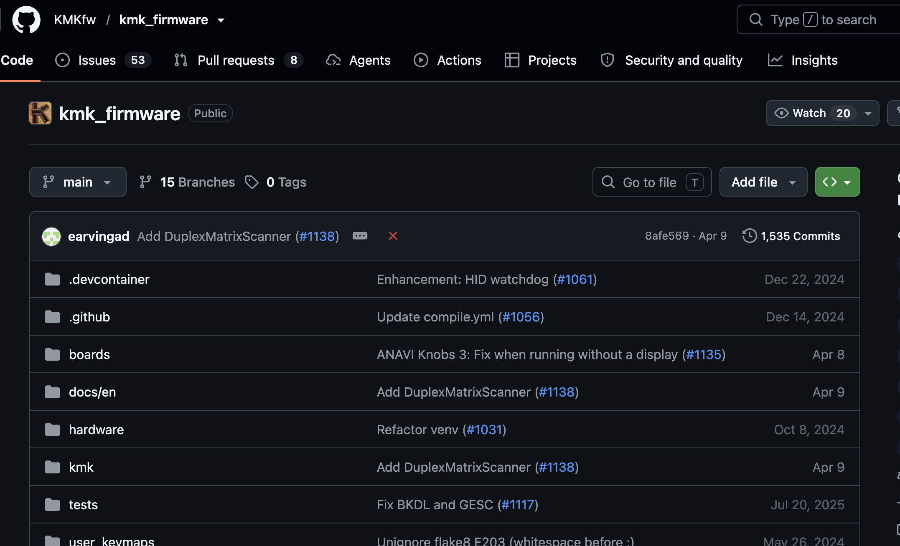
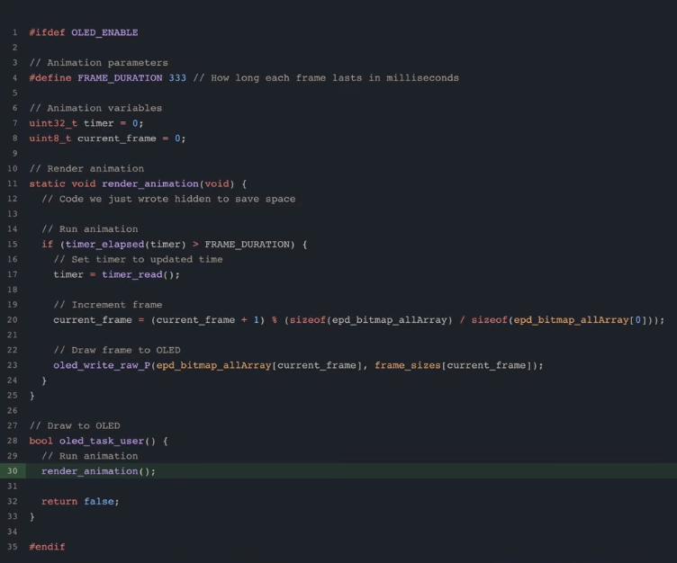
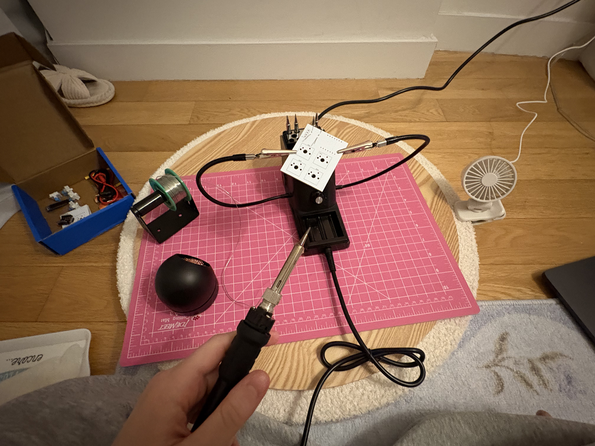
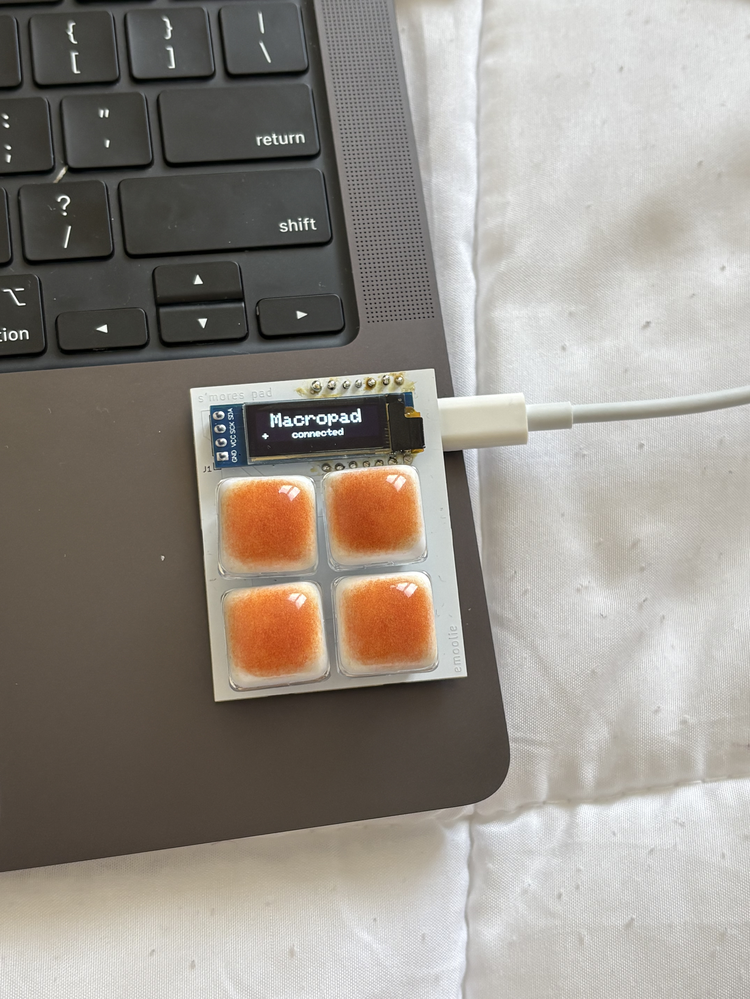

# October 7: Designign in Figma, determining component placement (3 hours)

I was working on this macropad as my first hardware project for Stasis back in April I think, but the guide was really hard for me to follow, so I finished making the PCB and tried to submit the project without any CAD or firmware (not cooking).

A few months ago I saw a really cute video of these girls with keychains that had keycaps of toasted bread, but they kind of looked like slightly burnt marshmallows to me, which gave me the idea to make a really cute s'mores themed macropad for end of summer/beginning of fall. I feel like the s'mores components will actually fit well into the design, as you can see below:

<p align="center">
  <br>
  <sub><i>First sketch of the s'mores layout</i></sub>
</p>

I might just make the PCB from scratch for practice and I want to adjust it to a small 1x3 rather than current 2x3.

Shoot I'm actually reconsidering this looking at my old design. It wouldn't be that hard to add a rotary or an OLED and that would make it much more useful. Back to the drawing board?

<p align="center">
  <br>
  <sub><i>Second sketch with an OLED</i></sub>
</p>

I'll plan on a 2x2 with an OLED and USB-C for power, I guess it'll just have to be plugged in at all times when I use it?

Instead of the SEEEDUINO-XIAO I'll use the XIAO-ESP32S3 I have. I keep forgetting if I have the c3 or s3. I think c3.

I just realized I don't need a USB-receptable or anything, I'll just use the USB-C on the xiao, I just need to make sure I expose it and in general, place the C3 carefully.

+ What's the difference between 3v3 and VUSB pin?
Correspond to different power rails, we won't use VUSB (5V)

+ If you're not using pins on an MCU in a wiring diagram should you add a no connect flag?
Yes

<p align="center">
  <br>
  <sub><i>General component placement</i></sub>
</p>

I'm planning to wire it like this.

<p align="center">
  <br>
  <sub><i>First schematic</i></sub>
</p>

This is what I've got, I'll double check with Claude. Claude mentioned:

+ Check if OLED contains I2C pull ups (Me & Claude çouldn't find it in the datasheet, Google says it's built in)
Because adding an additional 4.7 Ω resistor won't damage or make it slower, I'll add it between the SDA and SCL pins connecting to the OLED.

<p align="center">
  <br>
  <sub><i>Added pull-up resistors</i></sub>
</p>

# October 8-9: Adjusting the schematic (4 hours)
+ Where should you add pwr_flags vs 3.3V in kicad?
Where power enters from an external source: I'll add to the VCC_3.3V pin on the C3.

+ Swap 3.3v with PWR_FLAG pin or just ignore?
I might need to add a USB-Receptable part of the wiring like my devboard. I won't need a separate receptable like the devboard because the C3 has the USB-C connector (Claude).

+ Should I add a pwr_flag to the GND output of the C3 as well?
Oh it's mainly for power outputs? Ohh I think I get it, you just put the power flag between the 3.3V or GND/whatever power symbol, just like you would with a resistor - on the net.

<p align="center">
  <br>
  <sub><i>PWR_FLAG placed correctly</i></sub>
</p>

I'll probably do through-hole resistors because that's easier to solder. For assigning the footprint, I'll expand the Resistor_THT and choose based on size and power rating. For a 4.7K resistor, [this axial](https://www.digikey.com/en/products/detail/stackpole-electronics-inc/CF14JT4K70/1741428?gclsrc=aw.ds&gad_source=4&gad_campaignid=20682878391&gbraid=0AAAAADrbLlhHagyj9VcMYXw5Jg6t3uN1_&gclid=CjwKCAjwoaLWBhAWEiwAnyitu0q7ZIoBEf24n7WvusGYdJZPNJ8Uxk2ilCPZ5ONNjpV8P_V0X50U-RoCQjoQAvD_BwE) is 0.25W and 0.091" Dia x 0.236" L (2.30mm x 6.00mm). If the hole diameter must be 0.1 mm to 0.3 mm larger than the resistor lead diameter, I need a footprint that's around 2.4 - 2.6 mm.

```
Resistor_THT:R_Axial_DIN0204_L3.6mm_D1.6mm_P7.62mm_Horizontal
```
L3.6mm: barrel/body length, D1.6mm: body diameter, P7.62mm: pitch/center-to-center distance - still don't really understand but this needs to match. Horizontal/vertical is the mounting orientation - I didn't know that actually mattered.

I'll look for the actual part I want to buy before assigning the footprint to make sure the pitch matches. I should just need 2 4.7K resistors. I'm kind of scared to use Aliexpress for now so I'll get a more expensive option that arrives earlier from Amazon that describes the body length and diameter as well as pitch. 

[This one](https://www.amazon.com/dp/B07HDFHPP3?niid=nl_cl_lst_a_1_1&ref_=nl_cl_lst_a_1_1&nrid=AMSVW953F9Z4BAB6X13X&th=1) approximates
Shell (body) length: 6mm
Max body diameter: 2.5mm

So I'll look for a footprint similar to L6mm_D2.5mm

<p align="center">
  <br>
  <sub><i>Resistor visual</i></sub>
</p>

and place it vertically to better fit the board. Next time I might just surface mount & PCBA it. When it arrives I have to mesaure the body and make sure its body is within .5 mm and choose Resistor_THT:R_Axial_DIN0207_L6.3mm_D2.5mm_P2.54mm_Vertical

<p align="center">
  <br>
  <sub><i>Footprints assigned</i></sub>
</p>

+ Switches have no external pull-up so use INPUT_PULLUP and read them as active-low
Figure this out when the parts arrive/designing firmware.

Let's gooo - no more errors. I was having a "current configuration does not include footprint library" error but I just re-assigned the footprint and it worked. Here's the wiring:

<p align="center">
  <br>
  <sub><i>Schematic v2</i></sub>
</p>

Let's check again with Claude then PCB time. Oh I did the pull ups on the resistors wrong. I'm going to re-orgnize the whole schematic based on the components and use labels for the digital pins. SDA and SCL should be bidirectional shaped labels, MCU digital pins are input shaped and those coming out of the other components are outputs.

<p align="center">
  <br>
  <sub><i>Schematic v3</i></sub>
</p>

Ok wiring looks good.

# October 10: Routing the PCB (6 hours 15m)

Maybe next time should've used a keyboard matrix?

<p align="center">
  <br>
  <sub><i>Keyboard matrix example</i></sub>
</p>

Placing the switches/keys is so frustrating. I saw a youtube comment saying to use a plugin so I might just use that. I'm trying to do the grid spacing, setting a grid origin point and moving with reference but it's not working (this happened last time too, a few months ago and I wasn't able to figure it out)

New plan because the OLED is lowkey huge: put the C3 behind the OLED so the USB-C still sticks out, but the new design will look more like this:

<p align="center">
  <br>
  <sub><i>New placement with the C3 behind the OLED</i></sub>
</p>

I'm planning to add ~ 1.5mm spacing between each component. Never mind, that looks huge in the 3D viewer. Oh but that's the indivudal switches, there's going to need to be space for the keycaps. I'll just keep them bordering each other, so no overlap.

<p align="center">
  <br>
  <sub><i>PCB switch placement</i></sub>
</p>

Oh my gosh I didn't realize vertical mounting was like z-axis vertical.

<p align="center">
  <br>
  <sub><i>Vertical resistor mounting (z-axis!)</i></sub>
</p>

That's horrible when would I need that.

I'm going to change the OLED I use as well to something smaller. [These look cute](https://www.amazon.com/AITRIP-Display-Compact-Self-Luminous-Projects/dp/B0F5WPZJ92/ref=sr_1_3?crid=1W4R4XG6EKCV5&dib=eyJ2IjoiMSJ9.3XLdBWCYkPI47uifaPVXK99n5IV_giyShHyUTwhnWVEDP-yJQa0B5RzTQDlgrxDCSBCv30FgSrZCUTYryvVypnn40UWekQQI2bAbhrSGSkYcp7x-KUrSyH3ivYsNBqbA5B57mn4_AdDgzZp3m5RYfosxBzJAf01tTG9NzWauOoSeACfzrY_SQSsK9G-0B-RS-Z5E1zmI8CP4NRw2GmF2fZKC277QnFr_n7N2xnK2WdH990BNvNBRzgvqPAHG3AvXepj0D5ViaBcreogHT7AdI-a7xTj7ATU093yoKpsHg-g.wDJkpx_Bcac2kKQFXO91Q54QMV_RH7YsK3zA3Og26pk&dib_tag=se&keywords=OLED%2Bdisplay%2Bfor%2Bpcb%2Bpresoldered&qid=1791608771&s=industrial&sprefix=oled%2Bdisplay%2Bfor%2Bpcb%2Bpresoldered%2Cindustrial%2C92&sr=1-3&th=1) and are white, not finding any presoldered ones.

+ Should I just put correctly wired header pins on the PCB instead of an OLED footprint?
I guess so, this OLED works with header pins with 2.54 mm spacing.

Here's the updated schematic, I just need to change the resistor footprints to horizontal mounting and assign the right header pins.

<p align="center">
  <br>
  <sub><i>Schematic with OLED header pins</i></sub>
</p>

Debating if I get surface mounted resistors and have them with the board.. Nah. These are the new footprints:

<p align="center">
  <br>
  <sub><i>New footprints</i></sub>
</p>

Back to the PCB.

I'm reconsidering the placement of the C3 to be -90° now that the OLED's pins are at the top. The USB would come in from the side, like this:

<p align="center">
  <br>
  <sub><i>C3 rotated -90° so USB-C comes in from the side</i></sub>
</p>

*Except the OLED would be smaller and square shaped.

I think I'll go with it.

I need to make sure the OLED isn't pre-soldered. Shoot ok so all of these are presoldered. I'll need to use a female socket/header socket instead. Cool - same symbol, just changing the footprint to PinSocket. Also I'll definitely stick to a vertical orientation:

<p align="center">
  <br>
  <sub><i>Vertical pin socket footprint</i></sub>
</p>


<p align="center">
  <br>
  <sub><i>Vertical socket in 3D view</i></sub>
</p>

Yeah that looks right. So do the horizontal mounted resistors.

Shoot I was looking at the hackpad gallery and I kind of like the 1x 0.91" 128x32 OLED Display more. I think it works with my current set up?

<p align="center">
  <br>
  <sub><i>PCB v1</i></sub>
</p>

This is what the PCB looks like, I want to prototype it in real life and measure it on my own before ordering the PCB, so I'll get the parts before.

# October 10: BOM time (1 hour)

Before I finalize the PCB, I want to have the physical components to play with so let's find them and order them.

+ 4.7K ohm resistors: I should already have from my arduino starter kit (I'll confirm in the morning)
+ [0.91 inch 128x32 I2C](https://www.amazon.com/gp/product/B07PDFCVXL/ref=ox_sc_act_image_1?smid=A2ZDGCOOU4F0SF&psc=1)
+ XIAO ESP32C3
+ [Marshmallow keycap](https://www.amazon.com/gp/product/B0GXKFVZB1/ref=ox_sc_act_title_2?smid=A2N8YDAE199BID&psc=1) - technically "toasted bread"

<p align="center">
  <br>
  <sub><i>OLED powered on</i></sub>
</p>

# October 12: Some parts arrived (2 hours 30m)

The self healing cutting mat (I think that's what it's called, or a cutting mat? - the mat that everyone who works in hardware/engineering has, but I got it in pink of course) and the OLED both arrived in the mail today, so I'm just waiting on the keycaps. I'm going to try to prototype the macropad with what I have so far

On the OLED, there's SCK and SDA which map to D8 and D4 respectively, I think that changes some of the pin outs.

Ok I just wired it up to the XIAO, apparently there's no indicator if the OLED is connected, the XIAO's LED is red so looks good.

Using the instructions from an [old project](https://github.com/emilyahmad/pear-phone/blob/main/journals/JOURNAL_2.md) to get the C3 board running with Arduino IDE.

Also installed Adafruit SSD1306 and Adafruit GFX libraries. Code didn't work, I'll try SCK to D5 instead. Worked when I ran the [following](https://github.com/emilyahmad/smores-pad/blob/main/code/TestingOLED.cpp). Now I'll measure it and figure out how I want the spacing, I got:

OLED: 37 x 10 mm
C3: 20 x 15 mm
*Need to figure out keycaps (probably ~19.05 mm)

Considered a new placement with the OLED in between the keycaps, but I'll stick to the OLED on top for now.

<p align="center">
  <br>
  <sub><i>Alternate placement: OLED between the keycaps</i></sub>
</p>

# October 13: Silkscreen (15m)
Started experimenting with silkscreens but kind of forgot how to do it (it's been a while).

<p align="center">
  <br>
  <sub><i>Silkscreen experiments</i></sub>
</p>

# October 15: Parts Arrived (1 hour 35m)
I oriented the pieces how I liked and measured them

<p align="center">
  <br>
  <sub><i>Physical parts oriented and measured</i></sub>
</p>

| Measurements | mm|
| -- | -- |
| Bottom-w | 35 mm|
| Top-w | 45 mm|
| Side | 55 mm|

Going to reorient the PCB to better fit these measurements and start researching a place to print my board.

Awesome, no warnings:

<p align="center">
  <br>
  <sub><i>Final PCB, no DRC warnings</i></sub>
</p>

And it's roughly 46 x 57 mm, I'll order it on JLCPCB even though I want to find a PCB mill/makerspace (researched but didn't find anything).

JLC board dimensions: 45.87 x 57.85 mm
It'd be cool if the board could be brown and that could be the chocolate looking piece, but I'll make it white in case the case doesn't cover parts of it so it blends in with the marshmallow keycaps.

# October 28: Researching QMK Firmware (30m)

<p align="center">
  <br>
  <sub><i>KMK firmware research</i></sub>
</p>

[OLED tutorial](https://www.youtube.com/watch?v=OJSOEStpPIo&t=213s)

### rules.mk
```
OLED_ENABLE = yes
LTO_ENABLE = yes
```

### keymap.c
```
#ifdef OLED_ENABLE

bool oled_task_user() {
    return false;
}

#endif
```

To display images:
+ bnw
+ same orientation
+ 128 x 32
+ export as jpeg
+ image to c++ (converts to byte array)
output to plain bytes, draw mode = vertical

```
#ifdef OLED_ENABLE

bool oled_task_user() {
    static const char image [] PROGMEM = {

    };
    
    oled_write_raw_p(image, sizeof(image));

    return false;
}

#endif
```

animations
<= 7 frames
gif --> individual frames in easy ezgif.com
make sure dimensions fit
split button, output = jpeg, download zip
same process for each image --> c++/bytecode,
set output to arduino code

<p align="center">
  <br>
  <sub><i>OLED animation converted to Arduino code</i></sub>
</p>

12:53 on [this tutorial](https://www.youtube.com/watch?v=hjml-K-pV4E&t=16s) for general keyboard

ignore everything, qmk is not compatible with my board, so I'll use kmk instead

+ install circuit python
+ copy basic files from kmk
+ copy board-specific files
+ hardware may require additional libraries (copy them)
another [helpful video](https://www.youtube.com/watch?v=Q97bFwjQ_vQ) at 5:23

# October 31: Parts arrived! (2 hr)

Yay PCB arrived, everything fits when I through-hole-putting-wise. I don't have 4.7k resistors but apparently I can use the 5k1 ones from my starter kit. I'll solder everything together tonight but I want to make a proper plan.

Tips for 3D printing
+ Case to align the switches
+ Consider rubber feet
<br>
<br>

<p align="center">
  <br>
  <sub><i>Soldering time</i></sub>
</p>

Following [this tutorial](), use [this website]() to create the dxf file for the plate

# November 1: Soldering fixes & firmware (1 hr)
New plan: desolder. the upper right key and solder the Xiao header pins better
I should've checked each component works before adding all of them

I kept resoldering and testing and it finally worked, this is the script I used:
```
#include <Wire.h>
#include <Adafruit_GFX.h>
#include <Adafruit_SSD1306.h>

#define SCREEN_WIDTH 128
#define SCREEN_HEIGHT 32
#define OLED_RESET -1
#define OLED_ADDRESS 0x3C

Adafruit_SSD1306 display(SCREEN_WIDTH, SCREEN_HEIGHT, &Wire, OLED_RESET);

const int pins[] = {D2, D3, D7, D8};
const char* names[] = {"SW1", "SW2", "SW3", "SW4"};
bool last[4] = {HIGH, HIGH, HIGH, HIGH};
unsigned long pressCount[4] = {0, 0, 0, 0};
int lastPressed = -1;

void draw() {
  display.clearDisplay();
  display.setTextSize(1);
  display.setTextColor(SSD1306_WHITE);

  // Line 1: live state of all four keys (# = held, . = up)
  display.setCursor(0, 0);
  display.print("Keys: ");
  for (int i = 0; i < 4; i++) {
    display.print(last[i] == LOW ? "# " : ". ");
  }

  // Line 2: last key pressed
  display.setCursor(0, 12);
  if (lastPressed >= 0) {
    display.print("Last: ");
    display.print(names[lastPressed]);
  } else {
    display.print("Press a key...");
  }

  // Line 3: press counts
  display.setCursor(0, 24);
  for (int i = 0; i < 4; i++) {
    display.print(pressCount[i]);
    display.print(" ");
  }
  display.display();
}

void setup() {
  Serial.begin(115200);
  delay(2000);

  for (int i = 0; i < 4; i++) pinMode(pins[i], INPUT_PULLUP);

  // Swapped pins: SDA = GPIO7, SCL = GPIO6
  Wire.begin(7, 6);

  if (!display.begin(SSD1306_SWITCHCAPVCC, OLED_ADDRESS)) {
    Serial.println("OLED not detected or initialization failed!");
    while (true) delay(1000);
  }

  Serial.println("Ready. Press keys.");
  draw();
}

void loop() {
  bool changed = false;
  for (int i = 0; i < 4; i++) {
    bool now = digitalRead(pins[i]);
    if (now != last[i]) {
      delay(10);                       // simple debounce
      now = digitalRead(pins[i]);
      if (now != last[i]) {
        last[i] = now;
        changed = true;
        if (now == LOW) {
          pressCount[i]++;
          lastPressed = i;
          Serial.printf("%s PRESSED\n", names[i]);
        } else {
          Serial.printf("%s released\n", names[i]);
        }
      }
    }
  }
  if (changed) draw();
}
```

Only burnt myself once. Also it doesn't look as pretty as I want as the keys aren't oriented completely straight and the flux didn't clean off nicely. I learned so much for next time though.

Omg she works, I'm so hapy.

I'll use the macropad for simple shortcuts for now:
SW1: copy, SW3:paste
SW2: open new window, close window

Using [this library](https://github.com/T-vK/ESP32-BLE-Keyboard) for the firmware.

SW1 = Cmd + option + left arrow key
SW3 = Cmd + option + right arrow key

SW2 = Cmd + L
SW4 = open terminal at that folder

Change the mapping, currently: SW2 and SW3 should be swapped

Open terminal at folder command: acts on the folder selected in Finder. Opening the terminal at the Finder window’s current folder with nothing selected has no built-in shortcut, though a small Shortcuts or AppleScript action can do it if that’s what you meant.

Here's the [finished code](https://github.com/emilyahmad/smores-pad/blob/main/code/FinalizedMacropad.cpp).

I'm so happy she's finally done

<p align="center">
  <br>
  <sub><i>The finished S'mores Pad</i></sub>
</p>

