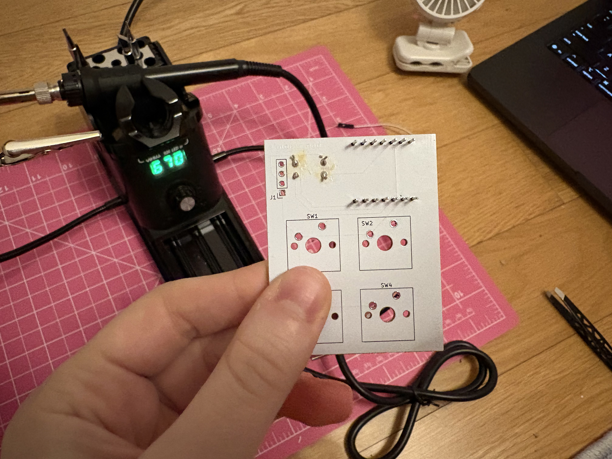
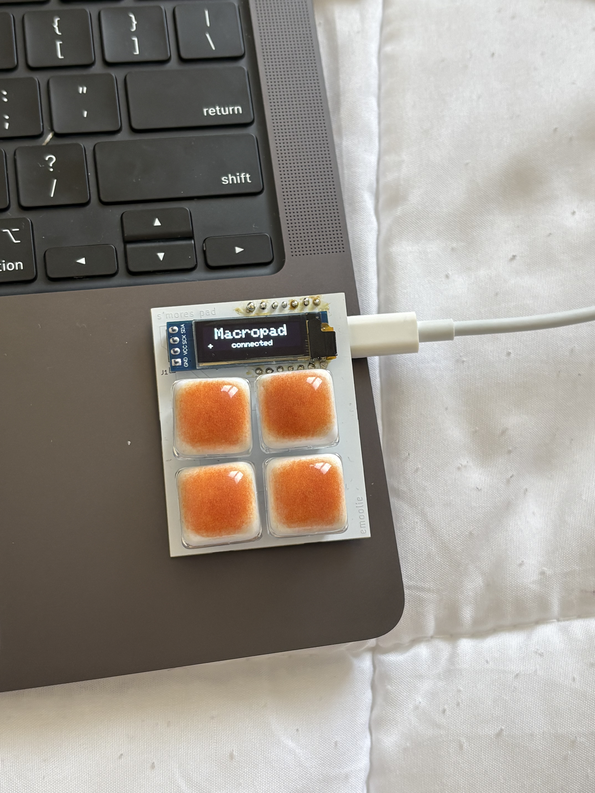
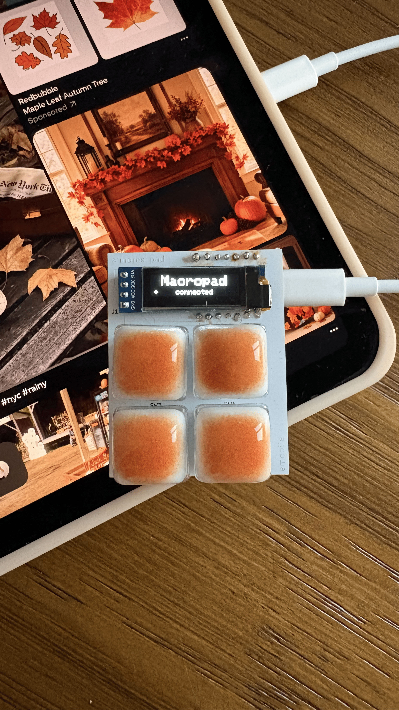

# S'mores Pad
A s'mores themed macropad with 4 keys and a 0.91" OLED, powered by a XIAO ESP32-C3. The marshmallow keycaps (took apart from those popular toasted bread fidget keychains) and chocolate and graham-cracker inspired 3D printed case (work-in-progress) make it a super cute accessory for fall. The XIAO's built-in USB-C is exposed on the side of the board for power and data.

Full build logs are in [JOURNAL.md](JOURNAL.md), and parts list is in [bom.csv](bom.csv).

<table>
  <tr>
    <td align="center">
       
      Soldered the resistors, placed the XIAO MCU
    </td>
    <td align="center">
       
      Finished S'mores Pad
    </td>
  </tr>
</table>

## Photos
<table>
  <tr>
    <th>Schematic</th>
    <th>PCB</th>
    <th>Final Product</th>
  </tr>
  <tr>
    <td align="center"></td>
    <td align="center"></td>
    <td align="center"></td>
  </tr>
</table>

Board size: 45.87 x 57.85 mm

## BOM

| Item    | Purpose                                | Quantity | Source                                                                                                 |
| ------- | -------------------------------------- | -------- | ------------------------------------------------------------------------------------------------------ |
| U1      | XIAO ESP32-C3 (MCU)                    | 1        | Seeed Studio                                                                                           |
| J1      | 1x4 female pin socket (mounts the OLED) | 1        |                                                                                                        |
| OLED    | 0.91" 128x32 I2C OLED (SSD1306)        | 1        | [Amazon](https://www.amazon.com/gp/product/B07PDFCVXL/ref=ox_sc_act_image_1?smid=A2ZDGCOOU4F0SF&psc=1) |
| R1, R2  | 5.1K I2C pull-ups (THT)                | 2        | Arduino starter kit                                                                                    |
| SW1-SW4 | Cherry MX switches                     | 4        | Amazon                                                                                                 |
| Keycaps | Marshmallow keycaps                    | 4        | [Amazon](https://www.amazon.com/gp/product/B0GXKFVZB1/ref=ox_sc_act_title_2?smid=A2N8YDAE199BID&psc=1) |
| PCB     | Mounting and wiring                    | 1        | JLCPCB                                                                                                 |

## Firmware
Bluetooth (BLE) keyboard firmware written in Arduino C++, using the [ESP32-BLE-Keyboard](https://github.com/T-vK/ESP32-BLE-Keyboard) and Adafruit SSD1306/GFX libraries.

| Key | Action                              |
| --- | ----------------------------------- |
| SW1 | Previous tab (Cmd + Option + Left)  |
| SW2 | Address bar (Cmd + L)               |
| SW3 | Next tab (Cmd + Option + Right)     |
| SW4 | New Terminal at Folder              |

+ [FinalizedMacropad.cpp](Code/FinalizedMacropad.cpp): the finished firmware
+ [KeySwitchTest.cpp](Code/KeySwitchTest.cpp): test sketch that shows key presses on the OLED
+ [TestingOLED.cpp](Code/TestingOLED.cpp): first OLED test
+ [QMK/](Code/QMK): early QMK snippets (not used, since QMK doesn't support the ESP32-C3)

Check out this [video demo](https://youtube.com/shorts/Tp6h0N3CoMg)